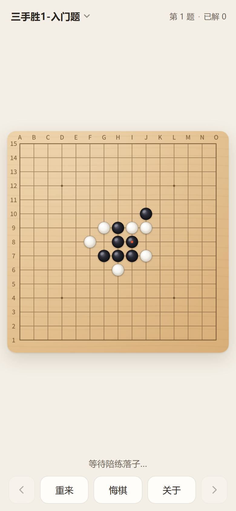

# 开宝五子棋陪练 · 网页版

> 把安卓应用《开宝五子棋陪练》搬到浏览器 / iPhone 上的实现。
>
> 规则引擎（连珠 + 禁手判定）、AI、界面均**重新编写**；棋盘、棋子、图标、音效与 433 道题库取自原版安装包，
> **仅用于个人学习与备份**，版权归原作者（孙俊）所有，请勿用于商业用途。若原作者提出要求，会立即移除相关素材。

一个纯前端的五子棋诘棋练习应用：8 套题库共 **433 题**、完整禁手规则、AI 陪练、可导入自定义题库。
无需联网、无需后端，打开即用。

**在线使用**：把本仓库开启 GitHub Pages 后，用 iPhone Safari 访问 → 分享 → 添加到主屏幕，
就是全屏、离线可用的 App。



> 详细安装步骤、导入题库格式、常见问题见 [使用说明.md](使用说明.md)。

---

## 目录

- `web/` —— 网页版（可直接部署；GitHub Pages 指向仓库根目录后访问 `/web/`）
- `单文件版/` —— 一体化 HTML，双击即可离线运行
- `ios/RenjuPartner/` —— 原生 iOS 工程（Xcode，需 Mac 编译）
- `数据/json/` —— 从原版安装包提取的题库原始数据
- `tests/` —— 规则引擎与对局流程的自动化测试
- `tools/` —— 构建、图标生成、本地服务器、工程校验脚本
- `预览截图/` —— 界面截图

---

## 快速开始（本地）

```bash
# 方式一：起一个本地服务器（推荐）
node tools/serve.js          # 然后浏览器打开 http://localhost:8000/

# 方式二：直接用单文件版
# 双击 单文件版/开宝五子棋陪练.html
```

在手机上试玩：双击 `启动手机测试.cmd`（Windows），iPhone 连同一个 Wi-Fi 后用 Safari 打开窗口里显示的地址。

---

## 测试

```bash
node tests/engine.test.js    # 规则引擎：禁手、胜负、AI 战术（24 项）
node tests/game.test.js      # 对局流程：先后手、悔棋、禁手判负（29 项）
```

---

## 构建

```bash
node tools/build_single.js   # 重新生成单文件版
python tools/build_puzzles.py   # 从 数据/json 重新生成 web/js/puzzles.js
```

---

## 已知限制

- AI 是本地重写的 JavaScript 引擎（α-β 搜索 + 精确禁手判定），棋力约相当于中级爱好者，
  达不到原版 SlowRenju 的强度。
- 进度保存在浏览器 localStorage，清理网站数据会丢失。
- iOS 原生工程只是 WKWebView 外壳，需在 Mac 上用 Xcode 编译。

---

## 素材来源与声明

- 原版：《开宝五子棋陪练》，作者 **孙俊**（2022）。
- 本仓库中的棋盘贴图、棋子图、应用图标、音效、《关于》文案与 433 道题库均从原版 APK 提取，
  仅作个人学习与备份使用，**版权归原作者所有**，本仓库不对其主张任何权利。
- 其余代码（`web/js/engine.js`、`game.js`、`ui.js`、`tools/`、`tests/` 等）为本项目编写。
- 如原作者不希望素材被转载，请提 Issue，会立即删除。

